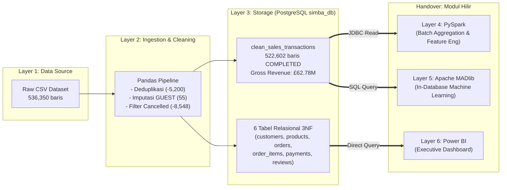

# SIMBA: Sistem Informasi Monitor Batch & Agregasi Stok (Kelompok 11)

**Program Studi:** Teknologi Rekayasa Perangkat Lunak, Sekolah Vokasi IPB University  
**Dokumen Handover Upstream:** Layer 1 (Data Source), Layer 2 (Ingestion Layer - Pandas), dan Layer 3 (Storage Layer - PostgreSQL)  
**Target Pembaca:** Tim Pengembang Layer 4 (Processing Layer - Apache PySpark) & Layer 5 (Analytics Layer - Apache MADlib)

---

## 1. Deskripsi Modul Hulu (Layer 1 s.d. Layer 3)

Modul ini bertanggung jawab atas pemrosesan data hulu (_upstream data pipeline_) pada arsitektur Big Data **SIMBA**:

1. **Layer 1 — Data Source:** Mengelola dataset transaksi mentah e-commerce berukuran **41,00 MB** (`Sales Transaction v.4a.csv`) dengan total **536.350 baris x 8 kolom**.
2. **Layer 2 — Ingestion & Cleaning Layer (Python/Pandas):**
   - Mengekstraksi data secara _batch_ ke memori (~168 MB RAM).
   - Melakukan validasi kelengkapan skema, audit integritas, dan pembersihan kualitas data (_data quality cleansing_).
   - Melakukan transformasi awal dan normalisasi data relasional.
3. **Layer 3 — Storage Layer (PostgreSQL `simba_db`):**
   - Membangun skema database relasional 3NF terindeks dengan _Primary Key_, _Foreign Key_, dan _Check Constraints_.
   - Menyimpan **6 Tabel Utama Relasional** dan **1 Tabel Denormalisasi Bersih** (`clean_sales_transactions`) secara bertahap (_batch ingestion_ `chunksize=10000`).



---

## 2. Informasi Dataset & Temuan Data Profiling

Berdasarkan hasil profil awal terhadap data sumber mentah `Sales Transaction v.4a.csv`:

- **Dimensi Data Mentah:** `536.350 baris` $\times$ `8 kolom` (`TransactionNo`, `Date`, `ProductNo`, `ProductName`, `Price`, `Quantity`, `CustomerNo`, `Country`).
- **Rentang Waktu Transaksi:** `2018-12-01` s.d. `2019-12-09` (1 tahun penuh transaksi).
- **Jumlah Produk Unik:** **3.768** produk katalog terdaftar (Rentang harga satuan valid: **£5.13 s.d. £660.62**).
- **Jumlah Pelanggan Unik:** **4.739** pelanggan (terdiri dari **4.738** pelanggan terdaftar dengan ID numerik + **1** pelanggan berlabel `'GUEST'`).
- **Jumlah Transaksi Unik:** **23.204** nomor pesanan belanja.
- **Transaksi Sukses (`COMPLETED`):** **522.602 baris** item pesanan dengan total nilai transaksi bruto (_Gross Revenue_) sebesar **£62.781.386,54**.

---

## 3. Logika Pembersihan Data (_Data Cleansing & Standardization_)

Sebelum data disalurkan ke PostgreSQL dan PySpark, 5 prosedur pembersihan data berikut telah diterapkan:

1. **Penghapusan Duplikat Identik (_Exact Duplicates_):**
   - Ditemukan **5.200 baris** (`0,97%`) data yang persis sama pada seluruh 8 kolom akibat redundansi pencatatan sistem kasir e-commerce.
   - Seluruh duplikat dihapus menggunakan `drop_duplicates()`, menyisakan **531.150 baris unik**. Hal ini penting agar tidak terjadi _overcounting_ stok dan omzet di PySpark.
2. **Pemisahan Transaksi Pembatalan / Retur (_Cancelled Orders_):**
   - Transaksi berawalan huruf `'C'` (misal: `C581484`) berkorelasi 100% dengan `Quantity <= 0`.
   - Total terdapat **8.548 baris** transaksi pembatalan (setelah deduplikasi).
   - Pada tabel `orders`, transaksi ini ditandai dengan flag `is_cancelled = TRUE` dan `order_status = 'CANCELLED'`.
   - **PENTING:** Seluruh 8.548 baris transaksi batal ini **telah difilter keluar dari tabel `clean_sales_transactions`**, sehingga Tim PySpark tidak perlu memfilter manual nilai kuantitas negatif!
3. **Imputasi Nilai Kosong (_Missing Value Handling_):**
   - Kolom `CustomerNo` memiliki **55 baris** bernilai kosong (`NaN`): 54 baris pada transaksi pembatalan dan 1 baris pada transaksi normal (`#558245`).
   - Seluruh baris kosong diimputasi dengan label string `'GUEST'`.
   - Format `CustomerNo` yang semula float (misal `17490.0`) telah dibersihkan menjadi format integer/string murni (`'17490'`).
4. **Standarisasi Format Tanggal & Rekayasa Fitur Waktu:**
   - Kolom `Date` bertipe string dengan format lokal Amerika (`M/D/YYYY`) distandarkan ke standar SQL ISO-8601 (`YYYY-MM-DD`).
   - Diekstrak fitur waktu turunan: `year`, `month`, `day`, dan `day_of_week` untuk mempermudah agregasi tren waktu pada PySpark & MADlib.
5. **Standarisasi Teks (_Whitespace Trimming_):**
   - Dilakukan penghapusan spasi liar (_leading/trailing whitespace_) pada kolom string: `TransactionNo`, `ProductNo`, `ProductName`, dan `Country`.

---

## 4. Skema 7 Tabel PostgreSQL & Panduan Penggunaan untuk Tim PySpark / MADlib

Di dalam database PostgreSQL `simba_db`, data telah dinormalisasi menjadi **7 tabel**:

|  No   | Nama Tabel                 | Jumlah Baris | Peran & Struktur Kunci                                                                                                                                                                                                            | Siapa yang Menggunakan?                                            |
| :---: | :------------------------- | :----------: | :-------------------------------------------------------------------------------------------------------------------------------------------------------------------------------------------------------------------------------- | :----------------------------------------------------------------- |
| **1** | `clean_sales_transactions` | **522.602**  | **Tabel Denormalisasi Bersih (COMPLETED)**<br>Kolom: `transaction_no`, `transaction_date`, `year`, `month`, `day`, `day_of_week`, `product_no`, `product_name`, `unit_price`, `quantity`, `line_total`, `customer_no`, `country`. | ⭐ **Wajib untuk Tim PySpark (Layer 4) & Apache MADlib (Layer 5)** |
| **2** | `customers`                |  **4.739**   | **Master Pelanggan (3NF)**<br>PK: `customer_no`, Kolom: `country`.                                                                                                                                                                | Power BI (Analisis Demografi Negara)                               |
| **3** | `products`                 |  **3.768**   | **Master Katalog Produk (3NF)**<br>PK: `product_no`, Kolom: `product_name`, `standard_price`.                                                                                                                                     | Power BI (Analisis Portofolio Produk)                              |
| **4** | `orders`                   |  **23.204**  | **Header Transaksi (3NF)**<br>PK: `transaction_no`, FK: `customer_no`<br>Status: `COMPLETED` (20.354) / `CANCELLED` (2.850).                                                                                                      | Power BI (Analisis Rasio Retur & Basket Size)                      |
| **5** | `order_items`              | **531.150**  | **Detail Item Keranjang (3NF)**<br>PK: `item_id`, FK: `transaction_no`, `product_no`.                                                                                                                                             | Power BI & Kueri Audit Relasional                                  |
| **6** | `payments`                 |  **23.204**  | **Transaksi Pembayaran (1-to-1 dengan Orders)**<br>PK: `payment_id`, FK: `transaction_no`, Status: `PAID` / `REFUNDED`.                                                                                                           | Power BI (Analisis Metode Pembayaran)                              |
| **7** | `reviews`                  |  **23.204**  | **Ulasan & Rating Transaksi**<br>PK: `review_id`, FK: `transaction_no`, `customer_no`, Nilai: `1 s.d. 5`.                                                                                                                         | Power BI & MADlib (Sentiment / Churn Analysis)                     |

> 📌 **CATATAN KHUSUS TIM PYSPARK:**  
> Untuk pekerjaan Layer 4 (Agregasi Stok Harian, Matriks Produk Terlaris, Agregasi Omzet Bulanan), Anda **TIDAK PERLU melakukan JOIN kompleks** ke 6 tabel relasional. Cukup baca langsung tabel **`clean_sales_transactions`**. Tabel ini sudah bersih, terdenormalisasi, memiliki kolom waktu lengkap, dan diindeks secara optimal (`idx_clean_tx_date`, `idx_clean_tx_product`).

---

## 5. Panduan 1-Click Setup di Laptop Tim (Cara Replikasi Database)

Jika teman kelompok ingin mereplikasi database `simba_db` di PostgreSQL lokal mereka dari awal, ikuti 4 langkah cepat ini:

### 1. Clone Repositori & Buat Virtual Environment

```bash
git clone https://github.com/aryomcz/simba_data.git
cd simba_data

# Buat virtual environment Python
python -m venv .venv

# Aktivasi virtual environment:
# Windows (PowerShell):
.\.venv\Scripts\Activate.ps1
# Linux / macOS:
source .venv/bin/activate

# Instal seluruh dependensi
pip install -r requirements.txt
```

### 2. Buat Database & Eksekusi Skema SQL di PostgreSQL

Pastikan service PostgreSQL lokal di laptop Anda aktif (`localhost:5432`), lalu buat database `simba_db`:

```bash
# Masuk ke psql atau jalankan langsung via command line:
psql -U postgres -h localhost -c "CREATE DATABASE simba_db;"

# Eksekusi DDL skema 7 tabel + indeks:
psql -U postgres -h localhost -d simba_db -f simba_postgres_schema.sql
```

### 3. Jalankan Batch Ingestion Otomatis (1 Perintah Selesai)

Jalankan script ingestion Python dengan menyertakan password PostgreSQL lokal Anda:

```bash
python simba_ingestion_pipeline.py --mode postgres --db-url "postgresql+psycopg2://postgres:<PASSWORD_KAMU>@localhost:5432/simba_db" --chunk-size 10000
```

_Pipeline akan otomatis membaca CSV mentah, membersihkan anomali, dan mengisi seluruh 7 tabel di PostgreSQL dalam waktu ~4-5 menit._

---

## 6. Snippet Kode Starter untuk Tim PySpark (Layer 4)

Berikut contoh kode PySpark siap pakai untuk membaca tabel `clean_sales_transactions` dari PostgreSQL lokal menggunakan konektor JDBC:

```python
from pyspark.sql import SparkSession
from pyspark.sql.functions import col, sum as _sum, count, desc

# 1. Inisialisasi SparkSession dengan PostgreSQL JDBC Driver (postgresql-42.x.x.jar)
spark = (
    SparkSession.builder
    .appName("SIMBA_Layer4_PySpark_Processing")
    .config("spark.jars.packages", "org.postgresql:postgresql:42.7.3")
    .master("local[*]")
    .getOrCreate()
)

# 2. Parameter Koneksi JDBC ke PostgreSQL simba_db
JDBC_URL = "jdbc:postgresql://localhost:5432/simba_db"
CONNECTION_PROPERTIES = {
    "user": "postgres",
    "password": "YOUR_POSTGRES_PASSWORD",
    "driver": "org.postgresql.Driver"
}

# 3. Baca Tabel clean_sales_transactions secara Terdistribusi
df_clean = (
    spark.read
    .jdbc(
        url=JDBC_URL,
        table="clean_sales_transactions",
        properties=CONNECTION_PROPERTIES
    )
)

print(f"Total baris terbaca di PySpark: {df_clean.count():,} baris")
df_clean.printSchema()
df_clean.show(5)

# 4. Contoh Task Agregasi: Top 10 Produk Terlaris berdasarkan Omzet
top_products = (
    df_clean
    .groupBy("product_no", "product_name")
    .agg(
        _sum("quantity").alias("total_units_sold"),
        _sum("line_total").alias("total_revenue")
    )
    .orderBy(desc("total_revenue"))
    .limit(10)
)

print("=== TOP 10 PRODUK DENGAN REVENUE TERTINGGI ===")
top_products.show(truncate=False)
```

---

## 7. Struktur Berkas Repositori

```text
├── .gitignore                          # Menjaga file rahasia & CSV besar (>50 MB) tidak ter-push
├── requirements.txt                    # Dependensi paket Python (pandas, sqlalchemy, psycopg2, ipykernel)
├── Sales Transaction v.4a.csv          # Sumber data transaksi mentah (41,00 MB)
├── simba_postgres_schema.sql           # DDL Skema 7 Tabel PostgreSQL & Indeks Kueri
├── simba_ingestion_pipeline.ipynb      # Notebook interaktif 8 sel (lengkap dengan hasil eksekusi)
├── simba_ingestion_pipeline.py         # Skrip Python CLI modular (--mode local / --mode postgres)
├── simba_data_ingestion_cleaning_plan.md # Spesifikasi teknis audit & acuan target metrik
├── output_clean_tables/                 # Artefak CSV bersih hasil normalisasi
│   ├── customers.csv                   # 4.739 baris
│   ├── products.csv                    # 3.768 baris
│   ├── orders.csv                      # 23.204 baris
│   ├── order_items.csv                 # 531.150 baris
│   ├── payments.csv                    # 23.204 baris
│   └── reviews.csv                     # 23.204 baris
└── README.md                           # Dokumen teknis serah-terima (handover)
```

_Dokumen serah-terima ini disusun oleh Upstream Data Engineer (Layer 1 s.d. Layer 3) — SIMBA Kelompok 11._
